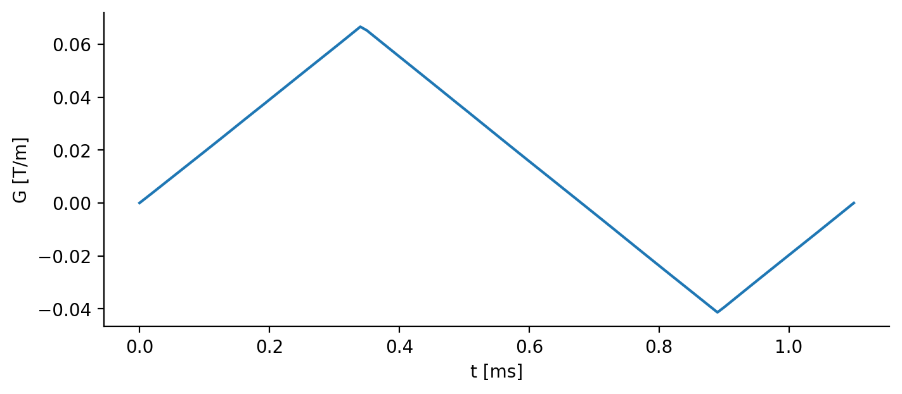

GrOpt is a toolbox for MRI Gradient Optimization (GrOpT). Rather than analytical combinations of trapezoids, the software uses optimization methods to generate arbitrary waveforms that are (hopefully) the most time optimal solution.

The main workhorse of the package are the optimization routines written in C++, which for final applications are designed to be compiled into a pulse sequence as needed. 

## Installation

```bash
pip install --pre gropt
```

GrOpt 2.0 is in pre-release, so the `--pre` flag is needed for now.

## Quick Start

```python
import gropt
```

In this example we generate a flow compensated phase encode, with a known duration (1.12 ms).

``` py
gparams = gropt.GroptParams()

# Set up problem
gparams.dt = 10e-6
gparams.N = 112
gparams.vec_init_simple()

# Add constraints
gparams.add_gmax(.08)
gparams.add_smax(200)
gparams.add_moment(0,14.0)
gparams.add_moment(1,0.0)

# Solve
result = gropt.solve(gparams)
out = result.X
```

Which produces the waveform:



## What It Can Do

- **Hardware limits**: gradient amplitude and slew rate, per axis or rotation invariant, constant or varying
  over time; PNS and cardiac stimulation with the SAFE model.
- **Waveform properties**: gradient moments of any order over any window, exactly or within a tolerance;
  b-value; eddy currents; concomitant-field balance.
- **Layout**: any number of samples and axes, with any samples fixed (nonzero end values, RF gaps, plateaus).
- **Objectives**: b-value maximization, minimum energy, and total-variation regularization.
- **Diffusion**: `gropt.diffusion` builds spin-echo diffusion problems from a short description and solves them
  with settings tuned over many problems, with TE searches and parameter sweeps.

## Next Steps

- [Python API Reference](python/gropt_py.md) — full documentation of the Python wrapper
- [Examples](examples/simple_example.ipynb) — Jupyter notebooks demonstrating common use cases, starting with
  this quick start
